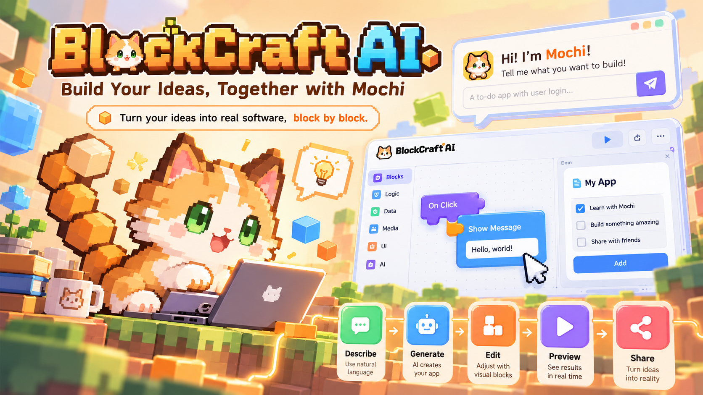

# 🧩 BlockCraft AI

<p align="center">
  
</p>

<h3 align="center">Build Your Ideas, Together with Mochi.</h3>

<p align="center">
  <strong>让每个人都能像搭积木一样创造自己的应用。</strong>
</p>

<p align="center">
  <a href="https://www.modelscope.cn/studios/Nanmuxxx/BlockCraft-AI-Test-7a2adbb-20261020">
    
  </a>
  <a href="https://github.com/Nanmuxxx/BlockCraft-AI">
    
  </a>
</p>

<p align="center">
  <a href="https://www.modelscope.cn/studios/Nanmuxxx/BlockCraft-AI-Test-7a2adbb-20261020"><strong>🌐 体验 BlockCraft AI</strong></a>
  ·
  <a href="https://github.com/Nanmuxxx/BlockCraft-AI/issues">反馈问题</a>
</p>

---

## 💡 项目简介

**BlockCraft AI** 是一个探索 AI 原生软件创造方式的学生创新项目，由浙江大学学生团队发起。

我们希望降低软件开发的门槛，让没有传统编程基础的用户，也能通过自然语言、可视化功能积木与 AI 协作，将自己的创意转化为可以运行的应用。

Scratch 将编程语句积木化，帮助学习者理解传统编程；BlockCraft AI 则希望进一步探索：**将软件功能积木化，让用户通过组合、调整和运行功能模块，学习如何创造真正的软件。**

我们正在探索面向青少年和初学者的 AI 原生软件创造教育，让学习者不只是使用 AI 生成结果，也能理解应用的组成、参与设计并持续改进自己的作品。

## ✨ 为什么选择 BlockCraft AI？

传统软件开发通常要求使用者学习编程语言、开发框架和复杂工具。单纯依靠一句话生成应用，也可能让用户难以理解内部结构，或难以精确调整局部功能。

BlockCraft AI 希望将 AI 的生成能力与可视化软件编辑结合起来：

- 💬 **自然语言驱动：** 从描述自己的创意开始。
- 🧩 **功能积木化：** 通过可视化模块理解和调整应用结构。
- 🤖 **AI 协作：** 让 AI 帮助用户实现想法、提出修改建议。
- 🖥️ **实际运行：** 在应用界面中体验和验证功能效果。
- 🔄 **持续迭代：** 鼓励用户参与设计、调整和完善作品。

我们的目标不是让 AI 代替用户创造，而是让 AI 帮助更多人学会创造。

## 🚀 核心功能

### 🧱 B 模式：可视化功能积木工作台

通过可视化工作台查看和调整应用的功能模块，帮助用户理解应用的组成结构。

用户可以围绕应用需求组织功能积木，并通过可视化交互逐步完善作品。

### 🖥️ C 模式：应用运行与交互体验

将应用结构转换为可交互的运行界面，让用户实际体验、测试和展示自己的作品。

B 模式与 C 模式围绕统一的应用结构协作，旨在让积木配置与最终运行结果保持一致。

### 🐱 Mochi：你的 AI 创作伙伴

Mochi 是 BlockCraft AI 的像素风格猫咪助手。

Mochi 不只是一个回答问题的聊天机器人，更是一个陪伴用户进行软件创作的 AI 伙伴。它旨在帮助用户理解需求、探索功能方案，并参与应用的逐步修改与完善。

### 🧠 AppSpec：统一的应用结构

项目采用结构化的 AppSpec 描述应用。

AI 生成、可视化积木编辑与应用运行围绕统一的数据结构协作，从而探索更可控的局部修改方式，减少每次调整都需要重新生成整个应用的问题。

> 注：具体功能可用性以当前代码和在线体验环境为准。部分 AI 能力可能依赖服务端配置。

---

## 🎓 我们的愿景：AI 原生软件创造教育

AI 时代的软件教育不仅需要探索如何编写代码，也值得关注如何与 AI 协作、拆解需求、设计功能并创造软件。

BlockCraft AI 正在探索面向青少年和初学者的软件创造教育体验，希望帮助学习者逐步掌握以下能力：

| 学习环节 | 核心能力 |
|---|---|
| 💡 Imagine | 发现问题，提出创意 |
| 🧩 Build | 拆解需求，组合软件功能 |
| 💬 Collaborate | 使用自然语言与 AI 协作 |
| 🧪 Test | 测试应用，发现并分析问题 |
| 🚀 Create | 完成作品，展示设计思路 |

我们希望学习者从软件的使用者，逐渐成长为软件的创造者。

---

## 🛠️ 技术架构

| 模块 | 技术或设计 |
|---|---|
| 前端 | React 19 |
| 编程语言 | TypeScript |
| 构建工具 | Vite |
| 应用描述 | AppSpec |
| 可视化编辑 | B 模式功能积木 |
| 应用运行 | C 模式 React 渲染 |
| AI 助手 | Mochi |
| AI 服务 | 受控服务端生成链路 |
| 容器化 | Docker 相关配置 |

### 核心工作流程

```text
用户描述应用创意
        │
        ▼
AI 辅助理解需求
        │
        ▼
结构化 AppSpec
        │
        ├───────────────┐
        ▼               ▼
 B 模式积木工作台    C 模式运行界面
        │               ▲
        │               │
        └── 修改与验证 ──┘
                │
                ▼
          持续迭代作品
```

这一架构的核心目标是让 AI、可视化编辑器和应用运行界面围绕同一份应用描述协作。

---

## 🌐 在线体验

欢迎通过魔搭创空间体验 BlockCraft AI。

<p align="center">
  <a href="https://www.modelscope.cn/studios/Nanmuxxx/BlockCraft-AI-Test-7a2adbb-20261020">
    
  </a>
</p>

**体验地址：**

https://www.modelscope.cn/studios/Nanmuxxx/BlockCraft-AI-Test-7a2adbb-20261020

在线体验环境的可用功能以实际部署版本为准。

---

## 💻 本地开发

### 环境准备

建议准备：

- Git
- Node.js
- npm

具体运行环境要求请以仓库中的配置文件为准。

### 1. 克隆仓库

```bash
git clone https://github.com/Nanmuxxx/BlockCraft-AI.git

cd BlockCraft-AI
```

### 2. 安装依赖

```bash
npm install
```

### 3. 启动开发服务器

```bash
npm run dev
```

根据终端输出，在浏览器中打开本地开发地址。

**注意：** 启动前端不代表所有 AI 服务都已配置完成。真实 AI 生成能力可能需要额外的服务端环境与授权配置。请参考仓库中的相关开发文档，切勿将 API Key 或其他秘密提交到 GitHub。

---

## 🗺️ 项目规划

以下为项目的探索方向，不代表所有功能均已实现或正式发布。

- [ ] 持续完善 B/C 模式的同步体验。
- [ ] 增强 Mochi 对上下文与局部修改的理解。
- [ ] 探索 AI 图像生成与视觉素材积木。
- [ ] 完善项目资源管理、保存与导出体验。
- [ ] 设计面向初学者的引导式创作流程。
- [ ] 探索面向青少年的 AI 软件创造课程。
- [ ] 通过用户访谈与试点验证教育场景的真实需求。

---

## 👥 关于我们

BlockCraft AI 由浙江大学学生团队发起。

项目从黑客松实践起步，团队希望探索生成式 AI 与可视化软件创造相结合的可能性，并进一步研究其在软件创造教育中的应用价值。

我们正在持续完善产品体验、技术架构和教育场景，探索如何让软件创造变得更加直观、可理解和有趣。

## 🤝 参与项目

欢迎关注项目进展、提出建议，或通过 GitHub Issues 反馈问题。

- **项目仓库：** https://github.com/Nanmuxxx/BlockCraft-AI
- **问题反馈：** https://github.com/Nanmuxxx/BlockCraft-AI/issues
- **在线体验：** https://www.modelscope.cn/studios/Nanmuxxx/BlockCraft-AI-Test-7a2adbb-20261020

## 📄 开源许可

请以仓库中的 `LICENSE` 文件为准。如果仓库尚未提供明确的开源许可证，请先确认项目的授权范围，再决定如何使用、修改或进行商业分发。

---

<p align="center">
  <strong>BlockCraft AI</strong>
  <br>
  Build Your Ideas, Together with Mochi. 🧩🐱
  <br><br>
  <em>从一个想法开始，用积木搭建属于你的软件。</em>
</p>
