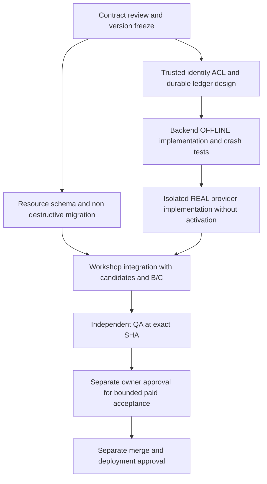

# Phase 2.1 REAL Wire / Provenance / Trusted Ledger RFC

Status: **REVIEW — proposal only; REAL implementation / acceptance BLOCKED**.
Author: current Supervisor / sole Resource-Contract Designer session (`/root`). Date: 2026-10-29, Asia/Shanghai.
Mode: **OFFLINE documentation audit**. `REAL_PROVIDER=NOT_RUN`. No provider transport, production configuration, keys, budget or deployment changed.

## Immutable baseline and scope

| Reference | Reverified full SHA | Meaning |
|---|---|---|
| main | `bcb6c1a7402ad4b4514feb4865c38d769d7244d1` | Remote main, not a destination for this task |
| Draft #98 | `77b8aadb3fe9dfb1e4ff4c1c50fa5a12bf02dbad` | HTTP Mock only; not REAL acceptance |
| Draft #99 | `bebe6f8e9a14e67752c6898b909ada3fd742e352` | This RFC's exact parent; isolated download/PNG preparation only |

Branch: `rfc/image-real-contract-20261029`. New isolated worktree; PR targets #99's `feat/image-phase2-preparation-20261029`, so its own delta is documentation only. All writes are inside `docs/acceptance/image-real-contract-rfc/**`. #98/#99/main histories remain unchanged. Rebase or dependency movement requires a new audit and renewed review; a green inherited CI run does not validate this RFC or REAL.

Related: [#91](https://github.com/Nanmuxxx/BlockCraft-AI/issues/91), [coordination #92](https://github.com/Nanmuxxx/BlockCraft-AI/issues/92), [#98](https://github.com/Nanmuxxx/BlockCraft-AI/pull/98), [#99](https://github.com/Nanmuxxx/BlockCraft-AI/pull/99).

## Read in order

1. [Source and remote audit](source-audit.md): facts versus missing capabilities, precise source links and audit limitations.
2. [Wire contract](real-wire-contract.md): versioned interfaces, independent task/billing state machines, recovery.
3. [Portable provenance](portable-provenance.md): typed resources, privacy, attestation and size policy.
4. [Trusted projects and ledger](trusted-project-ledger.md): authority chain, durable atomic transactions and unknown charges.
5. [Migration matrix](migration-matrix.md): explicit version allocation, JSON/ZIP/IDB/B-C consistency and rollback.
6. [Acceptance matrix](acceptance-matrix.md): proposed executable cases and separate approval gates.
7. [Actual reviews and execution evidence](review-record.md): only actual responses are ACK; scope of ACK is this documentation, never provider ACCEPT.

## Decisions proposed by this RFC

These are normative design choices **pending the reviews below**, not claims about current code:

- D1: closed REAL v2 and HTTP_MOCK v2 discriminators and routes; leave v1 strictly Mock. No client switch grants authority.
- D2: durable job state and charge state are independent. Dispatch uncertainty freezes the affected approval; no automatic regeneration, refund or reservation release.
- D3: resource schema 2 carried by CustomProject format 3, project JSON/package envelope 2 and IDB database 3. AppSpec remains version 1/2 because block semantics are unchanged. A new ProjectState validator and project-format capability gate are required; no compatibility claim for current readers.
- D4: retain current image and file budgets; reject oversized outputs without a paid retry. Initial REAL supports the strict bounded PNG subset only, no automatic transcoder. Normalization is a separately reviewed later policy.
- D5: proposed durable relational transaction backend (PostgreSQL) with fenced dispatch; deployment and storage operations are not authorized by this RFC. No in-memory fallback.
- D6: portable server attestation using a versioned Ed25519 public verification profile with signed RECONCILED adoption eligibility; UNKNOWN candidates receive no portable proof. Signing infrastructure/trust distribution are prerequisites, not available capabilities. Untrusted imported source claims never grant a verified REAL badge.
- D7: monetary accounting uses exact integer **nano currency units** (`10^-9` CNY or USD), decimal strings on wire, currency-separated buckets, no FX. This preserves precision naming of the existing text ledger without reusing its policies or funds.

## Blockers and accountable decisions

| ID | Owner | Needed decision / evidence | Blocks |
|---|---|---|---|
| B1 | Image-Backend + deployment owner | Establish a server project registry, authenticated principal mapping, ACL revision/operation checks, transfer semantics and hosting facts | All REAL creation/read/cancel; existing browser ownership is insufficient |
| B2 | Image-Backend + infrastructure owner | Approve durable DB, transaction/isolation/outbox/fencing and backup/restore proof; no image ledger currently exists | Reservation/dispatch and multi-instance operation |
| B3 | Cost-Security + accountable budget owner | Official fixed model/region/price/currency/usage/cancellation/idempotency evidence, upper-bound cost, explicit image approval with expiry and ceilings | Any real network/paid call; no amount is granted here |
| B4 | Resource-Contract + Workshop | Review D1/D3/D4/D6, exact version/capability gates, trust keys and atomic migration implementation plan | Shared model/UI changes, portable verified REAL |
| B5 | Independent QA | Review exact implementation SHA and every applicable offline/fault test, then separately authorized live evidence | REAL ACCEPT, merge/deploy gates |

Current deployment facts are NOT_VERIFIED. Source confirms no image production ACL/ledger wiring. This document can be reviewed while REAL remains BLOCKED. No request to change approval scope is made in this task: `approval_needed=NONE`.

## Sole file ownership and dependency order

| Owner | Exclusive future write scope (must be assigned before work) | Required upstream contract |
|---|---|---|
| Resource-Contract | This RFC; `server/image-generation/contract.ts`; `src/model/appSpec.ts`, `appSpecValidation.ts`; `src/custom-block/{types,project,json}.ts`; shared resource schema, migration and JSON/ZIP codecs | D1/D3 ratified; Backend and Workshop review first |
| Image-Backend | Provider/coordinator and new auth/project/image-ledger modules; server routing; backend tests | Frozen wire schema; B1/B2/B3; no edits to shared contract files |
| Image-Workshop | `src/integrations/gallery-generation/**`, project-workspace/session/repository, B/C integration and UI tests | Frozen resource/migration codecs; backend authenticated job and attestation contract |
| Cost-Security | Provider evidence/price/approval threat-review documents, cost-security tests | Backend transport and durable ledger design; no production approval edit |
| Independent QA | Independent acceptance tests/reports and exact SHA evidence | All owners deliver reviewable commits; QA does not author feature fixes |

Codec scope means `src/integrations/project-json/{format,database}.ts`, `src/integrations/project-package/{format,file,json,zip,security,image}.ts` and shared migration helpers; Resource-Contract is sole writer. Workshop consumes them, never forks its own serializer. Touching a file outside the assigned set requires an explicit #92 ownership transfer before editing, not simultaneous changes. These are future reservations, not permission to implement in this docs task.

Rollback for this RFC: leave Draft unmerged, or make a reviewed docs-only revert of its commit. No data conversion ran; do not reset dependencies, erase review history, clear idempotency records or alter deployed data. Implementation rollback requirements are in the migration and ledger documents.
