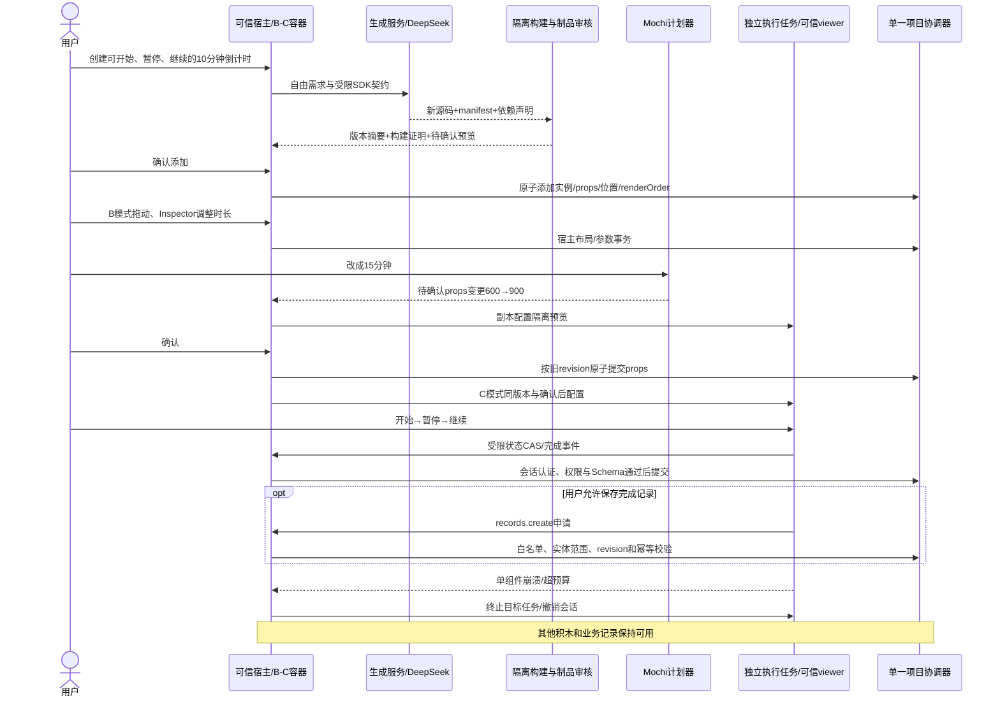

# CustomBlock：已批准架构与 Phase 1A 实现记录

状态：Phase 1A 协议与数据基础完成，待 Tech Lead 审核。最终目标仍是自由需求产生新的 React/JavaScript 功能代码，经 B 模式编辑、Mochi 确认修改，在 C 模式安全运行。本阶段没有生成、编译或执行该代码，也没有新增倒计时 UI。

## 1. Git 基线、范围与现有扩展点

2026-10-18 开工时通过已认证 GitHub connector 的 `fetch_commit(main)` 确认远端 main 为 `699ee2fd2c5ec0dca695d18b9468bdd7a69dbc43`（PR #13 的集成提交）。本地 main 为 `3e4a498c5c429cdb6d6b1e04a1022c3caaa18fa9`，缓存 origin/main 恰与远端一致。HTTPS `ls-remote` 因无本机凭据失败；没有将缓存引用单独当作远端证据。GitHub 未返回 CI 状态，随后在新 Worktree 上运行原有 120 项测试和生产构建，均通过。

指定目录和分支开工时均不存在，已从上述精确 SHA 新建：

- Worktree：`/Users/nanmuxun/BlockAI/BlockCraft-AI-custom-block`
- 分支：`feature/ai-custom-block`

开工检查的 6 个既有 Worktree：main、ai-quality、change-planning、deepseek-general-integration、general-generation、text-compat；检查时均无未提交文件。其他 Agent 可继续推进其分支，本实现不读取它们作为产品基线，不修改其工作文件。实现阶段没有移动 main、reset、rebase、clean、提交、推送、PR、合并或部署。

PR 交付审核时，Tech Lead 已授权精确提交这 13 个新增文件、发布独立分支并创建目标为 main 的 PR。通过 GitHub connector 再次核实 main 为 `8d6d837999edcd71b4d1d7765d792fe6c4f45681`，较开发基线前进 2 个提交（G2 接线及 PR #14 合并）；其 5 个变更文件与本次新增文件无重叠。保留当前开发历史，不擅自 rebase 或合并 main；实际冲突状态以创建后的 PR 为准。本地 main 和其他 Worktree 保持原状。

| 现有源文件 | 审计结论与后续扩展点（1A 均未改动） |
| --- | --- |
| `src/model/appSpec.ts` | v1 仅含 form/list/metric；ProjectState 持有 spec、records、blockPositions 和 revision。使用独立 v2 外层，不增加 v1 的 custom 联合类型。 |
| `src/model/appSpecValidation.ts` | 精确键、全局结构 ID、绑定、字段和记录验证仍是 v1 权威。v2 在 JSON 边界后复用原验证器，绝不放宽它。 |
| `src/model/appRuntime.ts` | 同一 Runtime 会话供 B/C 订阅，负责记录、布局和结构变化；没有接入 v2 或另建可写 Runtime。 |
| `src/model/appCommands.ts` | revision、原子命令、requestId 幂等和整批撤销语义保留。未来协调器不能用两个活跃 revision 镜像同步。 |
| `src/model/appChangePlan.ts` | Phase A 的命令白名单与 preview/confirm/stale 契约保留；未来 CustomBlock 计划走独立适配层。 |
| `src/components/app-builder/AppSpecCanvas.tsx` | 当前按 v1 block ID 选择并通过 Runtime.moveBlock 拖动；未来增加独立 v2 投影和宿主拖动句柄。 |
| `src/components/app-builder/AppSpecInspector.tsx` | 当前配置内置字段，读取最新快照后发命令；未来动态 Schema Inspector 仍须经宿主事务确认。 |
| `src/components/app-builder/AppSpecWorkshop.tsx` | B/C 共用现有 Runtime；未来 v2 容器读取同一 versionDigest/props，不复制运行态。 |
| `src/components/app-renderer/AppRenderer.tsx` | v1 blocks 数组为显示顺序；未来 v2 组合器依据 renderOrder 挂载可信查看器，不能直接 import AI 组件。 |
| `src/components/app-builder/AppSpecMochiPanel.tsx` | 此基线只有本地只读提示，尚非真实聊天修改器；没有 `src/components/mochi-ai/` 目录。另有 MochiPanel/MochiCat，全部冻结。 |
| `server/index.mjs` | 现有 `/api/ai/generate` 返回 v1，主 Node 服务不得执行任意生成代码。 |
| `server/aiGenerationPrompt.mjs` | G1 提示构造器明确限于 v1，与未来生成源码的 Prompt 分开。 |
| `server/aiGenerationQuality.mjs` | v1 结构/完整性/需求证据分层；合法 JSON 不代表功能正确，也不代表代码获得运行授权。 |

Phase 1A 新代码只被独立测试导入，没有接到产品入口。没有改变 AiCreate、品牌、旧 Demo、UI、CSS、奶油色 `#FFFBF6`、橘色 `#F28C52`、Pixelify Sans Logo 或 `src/assets/mochi.png`。

## 2. 已实现的最小协议

实际类型以 `src/custom-block/types.ts` 为准。协议版本彼此独立：项目 `formatVersion:2`、源码制品 `artifactVersion:1`、manifest `protocolVersion:1`、消息 `custom-block/1`，SDK 固定 `1.0.0`。未知版本和多余字段均拒绝，不做猜测升级。

```ts
type CustomProject = {
  formatVersion: 2
  revision: number
  base: Omit<ProjectState, 'revision'>
  custom: {
    instances: CustomBlockInstance[]
    positions: Record<string, { x: number; y: number }>
    states: Record<string, {
      versionDigest: VersionDigest
      stateRevision: number
      value: JsonObject
    }>
  }
  renderOrder: Array<{ kind: 'builtin' | 'custom'; id: string }>
}
type CustomBlockInstance = {
  id: string
  definitionId: string
  versionDigest: `sha256:${string}`
  props: JsonObject
}
```

`id` 是画布实例身份；除该身份外，实例只存 definitionId、固定 versionDigest 和经匹配 manifest 验证的 props。名称来自 manifest；没有源码、HTML、脚本 URL、可执行闭包、权限授予或 `latest`。

校验规则：

- v1 全部原有规则继续执行。实例 ID 不能与 app、entity、field、builtin block、relation 或其他 custom 实例冲突；definitionId 属于制品命名空间，可以复用；record ID 继续保持 v1 的实体内作用域。
- ID 采用 v1 的 ASCII 稳定格式，长度 1–128，禁用 `__proto__`、`prototype`、`constructor`。
- 每个 custom 实例必须有一个 `[0,1] × [0,1]` 的有限坐标，禁止悬空位置和多余坐标键。v1 可省略位置的语义原样保留，不自动填布局。
- renderOrder 必须恰好覆盖所有内置/自定义积木一次，类别和引用一致；不会重排 v1 blocks 或记录数组。
- state slot 可缺省，但存在时必须引用同一实例 versionDigest，值通过该版本 stateSchema。stateRevision 是实例状态 CAS 计数，不是第二个项目 revision。
- manifest 中 `records.create` 的目标实体即使只是权限请求，也必须属于当前项目。

### 受限 Schema 与 JSON 边界

支持 object/string/boolean/number/integer。object 必须显式 `properties`、`required`、`additionalProperties:false`。string 必须有 `maxLength`，可选 minLength；数值可选 minimum/maximum；标量可选有界 enum；title 只作文本。props、state、event 根必须是 object。integer 要求安全整数，number 要求有限数。

不支持数组 Schema、null 类型、`$ref`、组合、正则、格式扩展、任意验证函数、默认值或隐式转换。可选字段不自动补值。Inspector 的后续控件映射可用 string→文本框、boolean→开关、number/integer→数值框、enum→选择框、object→字段组；1A 不生成 UI。

Schema 上限：深度 8（根为 0）、节点 256、每个 object 32 属性、enum 32 值、string 4096 UTF-16 code units。required 必须唯一且引用真实属性。每份 Schema 独立计预算，manifest 的事件最多 16 个。

`assertJson` 先检查普通对象/数组的数据描述符，拒绝访问器、隐藏属性、Symbol、undefined、函数、BigInt、非有限数、循环、稀疏/扩展数组、类实例和危险键；不调用 toJSON、不读取 getter。只接受受限 JSON 数据，不应把本机插件产生的 Proxy 当成不可信 JSON 输入：Proxy 的反射 trap 无法由纯 JS 安全探测，真实传输边界必须先限制字节并 JSON.parse。

| 预算 | 普通项目/制品 JSON | 单条消息 JSON |
| --- | --- | --- |
| 最大嵌套深度，根为 0 | 32 | 12 |
| 值节点总数，包含根 | 100000 | 2048 |
| 单对象键数 | 2048 | 64 |
| 单数组长度 | 10000 | 128 |
| 单字符串长度，UTF-16 | 262144 | 4096 |
| 字符串与键名累计长度，UTF-16 | 2000000 | 16384 |
| JSON.stringify 后 UTF-8 字节 | 4000000 | 32768 |

1A 对内存对象设上述预算；未来 HTTP/消息接收器还必须在解析前做传输字节限额，不能靠解析后的验证避免分配攻击。

## 3. 制品、不可变版本与授权区分

`SourceArtifact` 是独立于项目的惰性数据：完整 manifest、路径到源码文本的 sources、精确 dependencies（版本与 SHA-512 SRI）、build（profile、工具链名称/版本/integrity、target、format、maxBundleBytes）。manifest 包含 definitionId/name、entry、propsSchema、stateSchema、events、requestedCapabilities。

`ArtifactRegistry.resolve({definitionId,versionDigest})` 只定义存储读取接口。1A 无持久注册表，无真实包下载，无编译器。测试使用内存替身。后续建议内容寻址存储 `definitions/<definitionId>/<digest>/artifact.json`，创建后不可覆盖，多个版本并存；宿主发布目录另存审核状态和签名，不写入用户可自报的“trusted”字段。

摘要规则固定如下，不能把任意格式正确的字符串当成可信版本：

1. 验证整个 SourceArtifact，拒绝未知键/版本。
2. 使用自定义 canonical JSON v1：对象键按 JS UTF-16 码元顺序 `.sort()`；数组保留顺序；键、字符串和有限数使用 ECMAScript JSON.stringify 的编码。无空格/额外换行；数值 `-0` 在摘要中按 JSON 的 `0` 编码。它不是泛称的任意“排序 JSON”，也不宣称实现 RFC 8785。
3. 将 `blockcraft:source-artifact:v1\n`（末尾一个 LF）与 canonical JSON 连接，以 UTF-8 编码后计算 SHA-256。
4. 输出 `sha256:` 加 64 位小写十六进制。

覆盖整个 manifest、所有源码路径和原始文本、所有依赖版本/integrity、全部构建约束。源码不进行 CRLF 或 Unicode 归一化；文本变更会改变摘要。语义相同的对象键插入顺序不改变摘要，数组顺序有意义。跨语言生产者必须严格复现编码规则，不能使用本语言默认数字/键排序来近似。

`resolveArtifact` 对注册表响应做安全 JSON 检查、独立复制、definitionId/digest 匹配并重算摘要；返回递归冻结的副本。`parseCustomProject` 在异步读取前复制项目，验证每个实例及其 props/state，避免校验过程中调用方变更输入。摘要错误、版本缺失或数据不匹配都会失败，绝不回退到新版本或默认参数。

当前 admission policy 限制依赖为 react/react-dom 精确 `19.3.1`；工具链描述固定 esbuild `0.25.12`；源文件最多 32 个、总 UTF-8 262144 字节；构建预算至多 524288 字节。只允许安全的相对文本路径和有限后缀，禁止 URL、绝对路径、穿越和大小写冲突。SDK 由 manifest 固定版本声明。

**这些是数据准入约束，不是依赖安全认证或已安装工具链。** SRI 目前只校验声明格式并纳入摘要，尚未获取对应包来核对字节，也未核验传递依赖或 import 图。源码可包含任意文本，包括不在白名单的 import，但它不能被本阶段执行。后续构建服务必须审核完整离线锁图、核对真实包字节与大小、固定 SDK/toolchain 的可信来源，并检查实际 bundle 大小；必要时新增 artifactVersion 以绑定输出 bundleDigest 和可信构建证明。不能把 source versionDigest 冒充运行 bundle 已验证或批准的证据。

## 4. v1 迁移与单一状态权威

`migrateProjectState(input)` 是纯函数：先经过 JSON 边界，再调用原 assertProjectState；复制原 spec/records/blockPositions，把原 revision 放在 v2 唯一顶层；custom 三个集合为空，renderOrder 按原 blocks 顺序初始化。它不改变传入对象、业务值、数组顺序、布局缺省或 revision，也不会创建 Runtime。迁移值中的数值 `-0` 会保留，摘要归一规则不用于迁移。

合法且在安全预算内的 v1 可以无损往返。超预算旧项目会显式报错，不会截断、静默丢数据或改写原文件。旧项目仍可通过未改变的原 v1 路径打开；v2 是显式选择，不是全库自动重存。

`exportProjectState` 仅在 custom instances/positions/states 全空，且 renderOrder 与 v1 blocks 顺序完全相同时复制输出。任何自定义内容或排序损失都拒绝；残留状态/位置本身先作为悬空引用拒绝。未知协议版本不能降级或猜测解析。

业务共享记录仍在 base.records；组件受控状态在 custom.states；props 只描述用户配置；不可变源码版本另存。三者不混合。1A 无写 API；将返回值交给原 Runtime 必须先安全导出为 v1。未来 v2 协调器必须独占项目 revision 和全部原子事务，只能提供受控 v1 视图/适配器，不能让旧 Runtime 与新 store 各自接受写入后再同步两个权威 revision。

## 5. 消息协议与信任边界

每条信封都严格要求：`protocol,channelId,sessionId,instanceId,versionDigest,seq,requestId,type,payload`，无额外属性。四个身份字符串采用稳定 ID 格式；digest 必须完整；seq 是从 1 开始的安全整数；所有 revision/CAS 计数均为非负安全整数。

| type | 精确 payload | 用途和后续限制 |
| --- | --- | --- |
| ready | sdkVersion | 组件→宿主就绪，不是授权请求 |
| state.compareAndSet | baseRevision、stateRevision、value | 组件→宿主申请受控状态写入 |
| event.emit | eventId、value | 组件→宿主声明事件；不直接产生业务副作用 |
| command.request | command=`records.create`、baseRevision、entityId、record{id,values} | 唯一预留业务命令，字段值限 v1 标量；不是通用 executeCommand |
| result | ok=true、committedRevision；或 ok=false、code | 宿主→组件，requestId 对应原请求 |
| error | code、message（最多 1024 UTF-16） | 错误诊断数据，只作为文本显示 |

`parseSandboxMessage` 只验证结构与预算并复制；`validateMessageData` 可进一步用已验证 manifest 校验 stateSchema/声明事件。业务字段、真实当前 revision、能力授予、读写范围、每个方向允许的消息和频率仍由未来网关验证。

**结构校验不认证发送者。** 即使消息可通过，instanceId/sessionId 可以是伪造文本，重复 seq/requestId 也可能通过。1A 没有监听 postMessage、没有 session/replay 状态、没有接受消息后写 Runtime 的路径。测试明确覆盖这一限制，避免将 Schema/digest 当作运行授权。

后续可信网关必须在结构校验之外实现：

1. 精确比较 event.origin 与部署配置中的独立 viewer origin，比较 event.source 与登记的 iframe.contentWindow；禁止 `*` 作为常规 targetOrigin。
2. 可信宿主创建高熵 channelId/sessionId 和单实例短期凭据，握手绑定 project/instance/version、窗口和 MessagePort；组件不能自行注册他人身份。Opaque origin 的 `"null"` 不是认证，不能作为通配可信 origin。
3. 每个方向独立递增 seq，拒绝重放；requestId 绑定消息指纹、项目/实例/版本/会话并幂等记账，响应必须对应真实请求。重载/换版撤销旧 port/凭据。
4. 核对宿主授予的 capability 与实体/字段范围；manifest request 不自动变成 grant。拒绝 undo、结构变更、源码/config/grant 修改、任意 AI 调用、任意网络和任意 JS 执行命令。
5. 在单一项目协调器中验证 baseRevision、stateRevision 和实际记录 Schema，原子提交并增加唯一项目 revision。冲突返回错误，不能改写成最新 revision 后静默重试。
6. 限制原始字节、解析深度、每实例/会话/用户消息频率、未完成请求数、日志总量；关闭异常会话。错误详情脱敏后作为文本，不渲染 HTML。

## 6. 执行安全架构：后续硬门槛，1A 尚未实现

最终允许新源码，但禁止在主 React tree、同源页面、主 Node 服务、node:vm 或普通 eval 中执行。iframe sandbox 本身不能提供完整安全或硬资源隔离。

建议独立构建服务与独立执行服务，均由可信控制平面启动受限任务：

- 构建任务在一次性隔离进程/容器或 microVM 中运行，非 root、只读工具链、受限临时盘、无宿主挂载/环境密钥/网络。依赖只从审核的离线缓存按精确锁图加载，禁用 lifecycle scripts、插件、动态外部解析与任意 npm 安装。工具链/SRI/包大小/输出大小需真实核验；外部 watchdog 强制编译时间、CPU、内存和进程数限额。
- 任意 React/JS 在每组件独立的远端浏览器进程/隔离任务中执行，独立临时 profile；网络层默认拒绝所有 egress（包括 DNS、loopback 和云 metadata），无用户 Cookie、持久存储、宿主 DOM 或密钥。状态仅在许可 IPC 中输入，默认不给业务记录。执行进程设 cgroup/容器或 microVM CPU/内存/进程/磁盘限额，宿主外部 watchdog 结束死循环，崩溃仅终止目标组件。
- 浏览器宿主只挂载独立跨站来源的**可信 viewer**，接收受限图像流/受控输入，不运行生成代码；生成源码不能通过 viewer 的 DOM、CSS 或消息冒充宿主。viewer 与应用使用不同可注册域名，无共享 Domain Cookie、认证 Cookie 或存储；凭据按实例短期绑定，不向生成进程提供 viewer 网络凭据。
- viewer 的 CSP 从 `default-src 'none'` 起步，仅放行固定版本 viewer 脚本、确有需要的样式/图像和精确流服务连接；`object-src 'none'; base-uri 'none'; form-action 'none'`，frame-ancestors 精确限定宿主。iframe 限制 scripts 外的弹窗、顶层导航、下载、表单和设备权限。精确来源握手与 CSP 头需要真实浏览器验收，不能用 blob/srcdoc 加 allow-same-origin 形成同源漏洞。
- 远端生成页面同样限制 CSP 作为纵深防御；不把它当网络隔离替代品。浏览器无法可靠完全禁止某来源对自身 Cookie/存储的使用，因此使用无身份的一次性远端 profile、任务销毁和无挂载来保证无宿主数据/无持久保存。

浏览器端 iframe/Worker 无法可靠强制每组件 CPU、内存和全网络访问上限；无限循环可能卡住渲染进程，移除 iframe 的 watchdog 也可能失去调度机会。仅 iframe 的本地原型最多用于受审代码实验，不能宣称达到任意 AI 源码的安全门槛。远端渲染方案需要验证延迟、输入法、可访问性、复制粘贴等体验，若无法承担隔离成本，则暂停开放任意源码执行。

防冒充：可信宿主绘制不可被组件覆盖的边框、组件名/ID、权限和确认按钮；Mochi 在可信区域独立渲染。组件被裁剪在所属区域，禁止宿主门户、全屏、顶层导航、跨实例消息和修改其他积木。内容仍可能在自身区域画出类似按钮或文字，技术上不能证明语义不欺骗；敏感确认必须在宿主区域完成。

## 7. Mochi 修改、预览、确认与恢复（后续）

参数修改：对固定 definitionId/versionDigest 产生 props patch，绑定 baseRevision、instanceId、旧 props 摘要和目标新 props；Schema 验证后显示差异及隔离预览。用户确认前不写项目；确认句柄属于生成它的可信 planner，不能从模型返回 JSON 复原有效确认。变更过期则重新预览，不自动刷新 revision。

源码修改：生成新的 SourceArtifact → 受限构建 → 安全准入和独立功能验收 → 新 digest 与审核记录 → 使用副本配置/状态进行隔离预览 → 展示源码/行为/权限差异 → 用户确认后原子切换实例引用。旧 digest 不改写。不兼容 stateSchema 时要求明确重置状态或受审的声明式迁移；不执行 AI 提供的迁移函数。

取消预览、编译失败、版本缺失、Schema 不匹配或确认冲突都保留原项目/版本/数据。运行崩溃或频率超限只销毁目标执行会话并显示可信错误占位；宿主按检查点重建或用户选择旧版本。回滚是针对目标组件的新事务，不能恢复整份旧项目覆盖后来记录；不可逆业务命令不得靠回滚组件假装撤销。日志和错误有字节/次数上限，不自动无限重启。

## 8. 倒计时端到端序列与验收（后续，非代码模板）

倒计时只作验收需求。Phase 1A fixture 源码特意写成不可执行的报错文本，所有测试仅验证数据协议；它不是 AI 输出，也不构成可运行倒计时。



运行状态建议记录 remainingSeconds/status 及宿主管理的时间检查点；每秒 tick 只在组件局部显示，不每秒改项目 revision。开始、暂停、继续按真实经过时间更新，后台节流不能导致倒计时停止计时；重配时明确“重置/下次生效”，不能意外复活过期会话。时间计算语义与完成事件去重需后续测试验证。

后续验收必须证明：模型实际产生此前不存在的源码，没有关键词模板；B 新积木可拖动、Inspector 能改 duration；Mochi 生成 900 秒待确认计划；未确认不生效，确认后 C 同版本启动；真实暂停/继续有效；保存结果只经授予的 records.create；一个组件死循环/崩溃不影响其他积木和数据。付费 DeepSeek 与部署必须另行授权。

## 9. 协作冲突、Phase 1B 最小接口与任务

| 工作流 | 潜在冲突 | 接口边界 |
| --- | --- | --- |
| G2/现有生成路由 | 同时改 server/index.mjs、响应格式和质量门禁 | 保留 v1 `/api/ai/generate`；未来源码生成/制品服务独立 API 与响应。不得让 G1 的 v1 Prompt 输出 JS。 |
| Mochi/Phase A | 同时改 planner、确认和选中积木上下文 | 新 custom planner 适配；保留旧 Phase A 四类命令，跨协议变更先定义事务与确认契约。 |
| B/C/Inspector | 同时修改核心组件及 CSS | 先实现独立 v2 adapter/viewer，再经专项授权接 UI；维持原视觉冻结。 |
| 部署 | 跨站来源、CSP/反代、隔离任务、凭据配置 | 基础设施负责人单独部署 viewer/build/runner；不将任意源码编译挂入现有 Node 主服务。 |

Phase 1B 必须先定义的最小接口（以下均未实现）：

1. **制品存储/准入**：按精确 ref 读取，隔离构建返回 sourceDigest、bundleDigest、锁图和可信构建证明；独立批准/撤销 API，不能由 manifest 自授信任。
2. **可信网关**：openSession/closeSession、origin/source/port 绑定、方向/序号/幂等、能力授予、预算；消息只进入经过审核的命令处理器。
3. **项目事务所有者**：getSnapshot/subscribe、preview/confirm、状态 CAS、记录命令、布局/props/换版事务，共用唯一 revision；明确与旧 Runtime 的互斥所有权，不先创建第二个可写 store。
4. **隔离执行与 viewer**：start/stop/restart、受控输入/输出、资源统计和崩溃上报，宿主为每个实例提供可信边界。

最小开发顺序：

1. 先用受审离线源码验证隔离构建、无网络/密钥、资源杀停与制品完整性；门槛未过不执行任意源码。
2. 打通单实例会话、认证、白名单/CAS 与故障恢复的集成测试，保留现有 v1 回归。
3. 经 UI 授权后增加 v2 B/C 组合器、宿主拖动和动态 Inspector，同一摘要与 props 跨模式使用。
4. 增加 custom Mochi 计划、配置差异预览/确认、不可变源码换版/回滚；验证 stale 与并发数据保护。
5. 最后接独立 AI 生成 API，获得授权后做真实倒计时验收；在此之前均标注离线 fixture，不宣传完整 AI 执行能力。

## 10. Phase 1A 文件与验证

新增目录和文件：

```text
src/custom-block/
  types.ts          # 协议数据类型
  json.ts           # 严格JSON/预算/基础检查/复制/规范编码
  schema.ts         # 受限Schema与数据验证
  artifacts.ts      # 源码制品、摘要与注册表读取验证
  project.ts        # 项目引用一致性、纯迁移和安全导出
  messages.ts       # 精确信封/载荷、可选manifest数据检查
  index.ts          # 独立公开接口
tests/custom-block/
  fixtures.cjs
  project.test.cjs
  schema-json.test.cjs
  artifacts.test.cjs
  messages.test.cjs
docs/custom-block-architecture.md
```

没有新增依赖，没有修改 package.json/lockfile。独立测试沿用仓库 TypeScript→CommonJS 的离线测试加载方式；`npm run build` 另外对 src 完整类型检查。node_modules 仅在本 Worktree 被忽略目录内链接现有依赖，不安装包。

| 检查命令 | 实际结果 |
| --- | --- |
| `node --test tests/custom-block/*.test.cjs` | 137/137 通过 |
| `npm test` | 原有 120/120 通过 |
| `node --test tests/ai-quality/*.test.cjs` | 83/83 通过 |
| `npm --prefix server test` | 23/23 通过，mock upstream |
| `npm run test:generation` | 20/20 通过，离线 fixture/mock |
| `npm run build` | TypeScript + Vite 通过；输出 JS/CSS 与开工基线同名同大小 |

独立测试覆盖无损迁移、旧 v1 Runtime、全局实例冲突、位置/引用/顺序、缺失/伪造版本、Schema 未知键/类型、非 JSON/访问器、消息精确载荷、身份字段/版本/序号/请求 ID、各预算边界、摘要规则与覆盖范围、多版本并存、注册表篡改、快照隔离及禁止有损降级。测试没有执行 fixture 源码，也没有调用真实 AI。

## 11. 最大三个风险、残余风险与不支持事项

1. **任意源码执行的隔离成本与浏览器兼容性**：远端进程隔离/渲染增加延迟和运维成本；本地 iframe 无法等价实现 CPU/内存/网络硬限额。1A 完全未实现沙箱，不能据协议测试宣布执行安全。
2. **模型代码和依赖的行为正确性**：合法 Schema、相同摘要和包白名单都不能证明倒计时逻辑正确、无欺骗内容或供应链安全。需要真实包核验、隔离构建、独立行为验收与宿主确认。
3. **版本切换与共享状态一致性**：换版、Mochi 计划、C 模式写入和旧 Phase A 并发可能互相覆盖。必须保持单 revision、CAS、stale 拒绝及定点补偿，不能复制整份旧快照回滚业务数据。

尚不支持：真实生成代码、AI 接入、执行器/编译器、浏览器会话网关、origin/端口认证、权限授予、Runtime 写入、v2 持久化服务、B/C 自定义 UI、动态 Inspector、Mochi 自定义修改、任意 npm、任意网络、原生模块、DOM 跨组件访问、文件/支付/消息发送、组件提供自定义迁移函数、无确认修改源码、自动升级/静默降级、跨设备/多人共享和硬资源隔离。

本次仅按新增授权提交、发布分支和创建独立 PR，交付后停止；合并、部署、付费模型调用和 Phase 1B 接线仍等待 Tech Lead 后续授权。
