# Mochi 自然运动与浏览器验收

本分支从 GitHub main `2d8ffe18f8c4fad787549c8998fc6175c7d9ebdc` 创建独立 worktree；未沿用历史 Mochi 分支。提交前再次查询 main，仍为该 SHA。

## 实现与集成边界

- 原 `src/assets/mochi.png` 与 `MochiCat` 原封保留。`MochiEmotion` 用独立身体层、像素眼睑和小符号表现 idle、curious、thinking、happy、celebrating、error。
- `motion/controller.ts` 只读 DOM，读取实际选中积木的位置与现有拖拽/拼接类名。`motion/geometry.ts` 选择安全落点，并为完整 58×58 点击区域规划避开积木、按钮和 Inspector 的路径。
- 位移使用 Web Animations API 的 `translate3d`；短而通畅的路径用正弦轻跳，其他路径分段移动。React state 只处理离散情绪事件，没有逐帧位移更新。无新增依赖。
- 滚动、拖拽、窗口/visualViewport 变化使用合并后的 DOM 测量直接跟随。选中切换及连续重选从当前视觉位置开始移动。拼接的短暂缩放期间继续测量。
- 首次出现直接定位；积木离屏、页面隐藏或没有安全空位时隐藏。安全空间不连通时留在先前安全位置，不穿过控件强行追赶。靠近视口边缘时允许改换安全侧，因此此时不保证固定相对偏移。
- overlay 外层不接收指针；仅静止猫咪按钮可点击。移动、拖拽期间按钮不接收指针。点击后显示并聚焦现有聊天输入；可选 `onActivate` 留给未来统一集成。
- 选择/拖拽 → curious，拼接 → celebrating，Inspector 保存 → happy，Inspector 错误 → error；现有宿主的 thinking/error 优先。呼吸周期 5.8s，眨眼周期 8.6s，观察周期 19s。
- `prefers-reduced-motion` 随时取消位移动画和 CSS 动画。≤4 逻辑 CPU、≤4GB 内存或节流数据提示时取消身体/眨眼动画及跳跃，保留简化移动。

没有修改 `WorkshopMochi.tsx`、AppRuntime、MochiHost、事务权限、DeepSeek API、猫咪资产或生产 AI 开关。控制器复用现有 Workshop DOM 信号，不需要集成负责人并发编辑接线文件。若日后更换画布结构，需要继续提供 `data-block-key`、`is-selected`、`is-dragging`、`is-snapped` 信号，或由集成负责人接入明确事件。

## 复现

安装项目依赖；运行浏览器脚本还需要可解析的 Playwright 和其 Chromium（可通过 `NODE_PATH` 指向已有安装）。

```sh
npm test
npm run build
npm run test:mochi-host
node --test tests/mochi-motion/geometry.test.cjs
node tests/mochi-motion/browser.cjs
npm run test:mochi:browser
```

动画脚本只在本机 Vite 临时路由 `/__motion` 挂载真实 MochiWorkshop + AppRuntime，使用明确标记的固定 Mock planner 触发思考/确认/错误，不调用 AI 或外网。该路由未接入生产应用。两套浏览器脚本各用独立 Vite 缓存，支持 worktree 的依赖目录符号链接。

## Chromium 证据

完整采样及检查结果：[browser-report.json](mochi-motion-evidence/browser-report.json)；原宿主回归：[host-browser-report.json](mochi-motion-evidence/host-browser-report.json)。1366×900 和 390×900 均检查选中移动、真实指针拖拽与取消、快速重选、拼接、滚动、B/C 切换、窗口变化、猫咪点击、Inspector 保存/错误、宿主思考/确认/错误、无横向溢出，以及 reduced-motion。在移动帧中检查可见性、中间位置、位置连续性和积木/控件重叠。额外模拟 2 逻辑 CPU 验证动画降级，并通过 Chromium 原生 TouchEvent 输入验证触摸拖拽提交与指针避让。

手机宽度是 Chromium 视口验收，不等同真实手机硬件性能测试。眨眼截图通过定位实际 CSS Animation 的时间生成，检查睁/闭眼不透明度；没有等待完整周期。原有宿主回归脚本继续检查权限、计划确认、数据保留与 StrictMode 清理。构建、157 项原单元测试、24 项 MochiHost 测试和 3 项新增几何测试通过；两套 Chromium 脚本通过，浏览器错误及外网请求为 0。

桌面连续帧（每帧间隔约 125ms）：

| 1 | 2 | 3 | 4 |
| --- | --- | --- | --- |
| 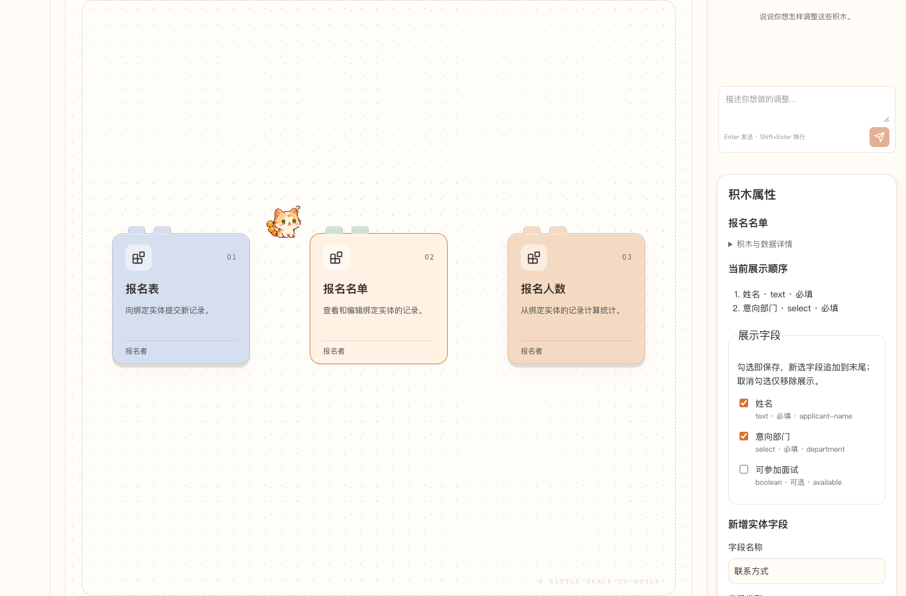 | 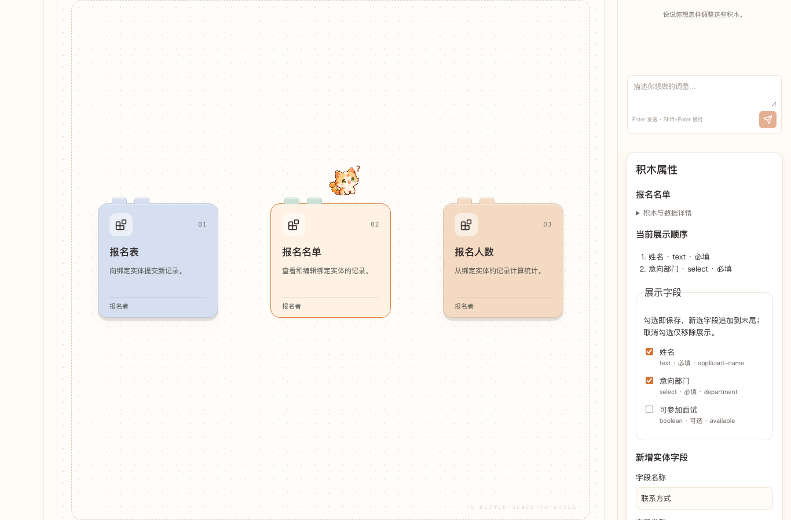 | 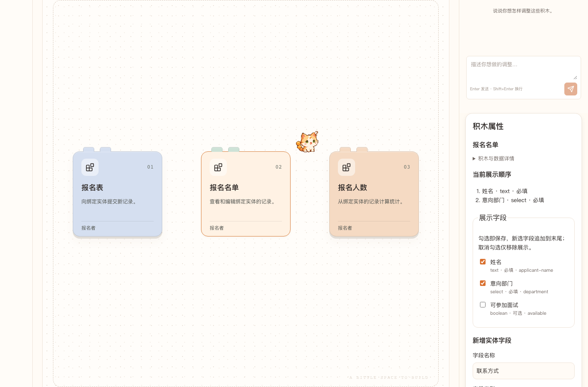 | 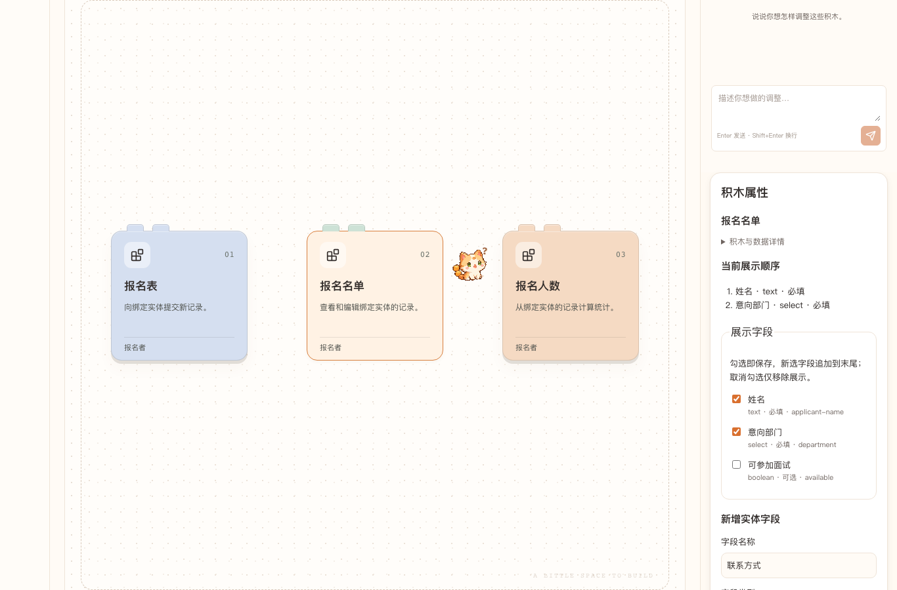 |

手机连续帧：

| 1 | 2 | 3 | 4 |
| --- | --- | --- | --- |
| 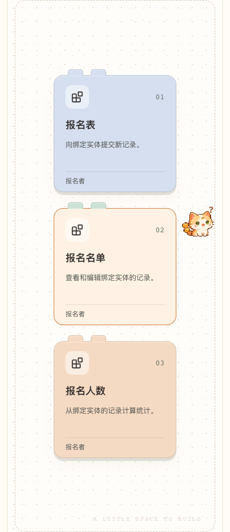 |  | 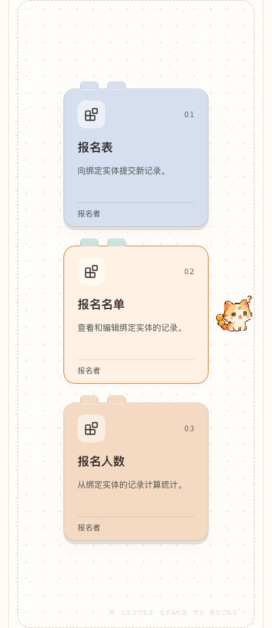 |  |

情绪与交互：

| 待机 | 闭眼 | 拖拽 | 拼接庆祝 |
| --- | --- | --- | --- |
| 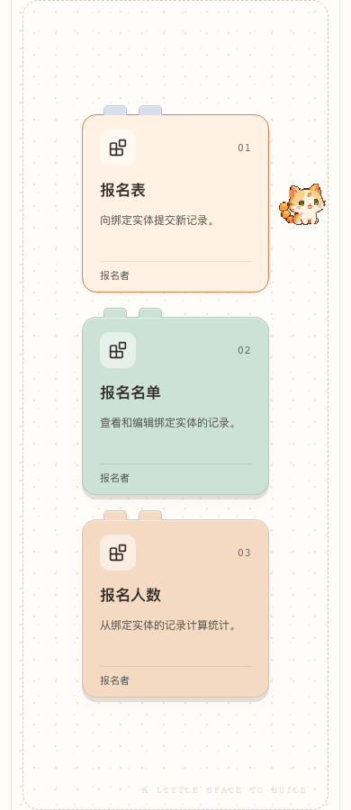 | 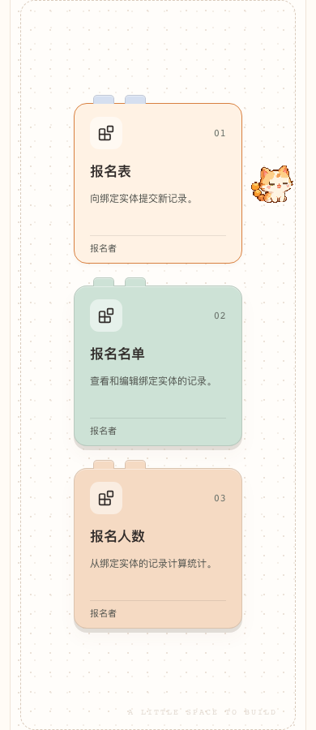 | 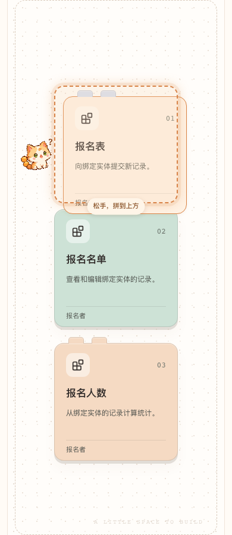 | 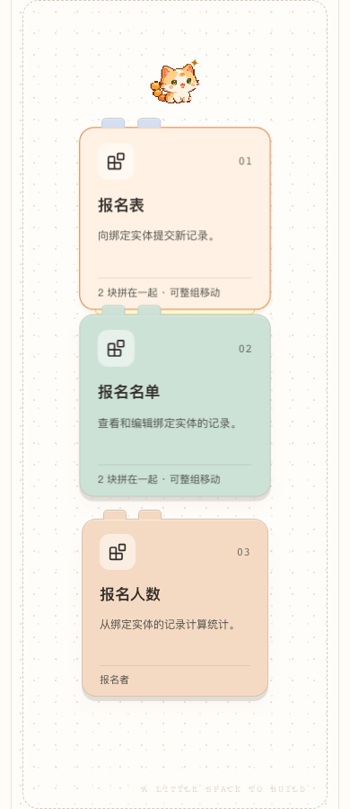 |

| 思考 | 保存 | 错误 | 减少动态效果 |
| --- | --- | --- | --- |
|  | 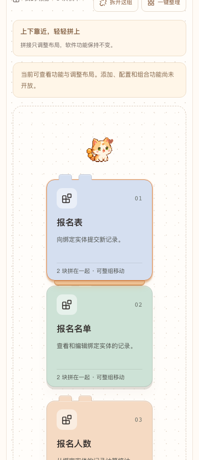 | 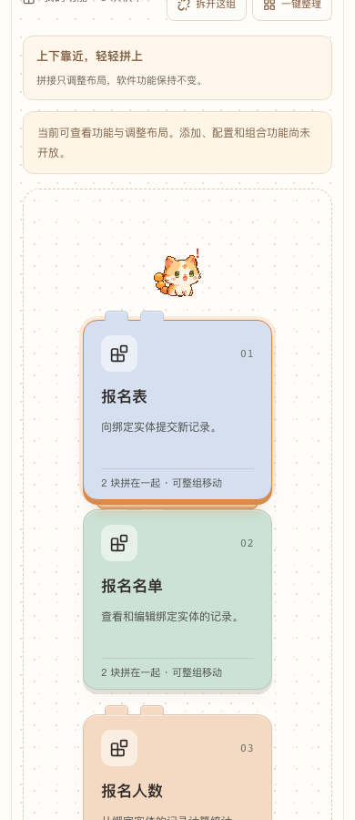 | 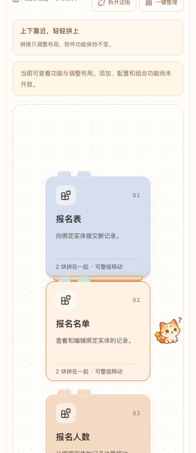 |
